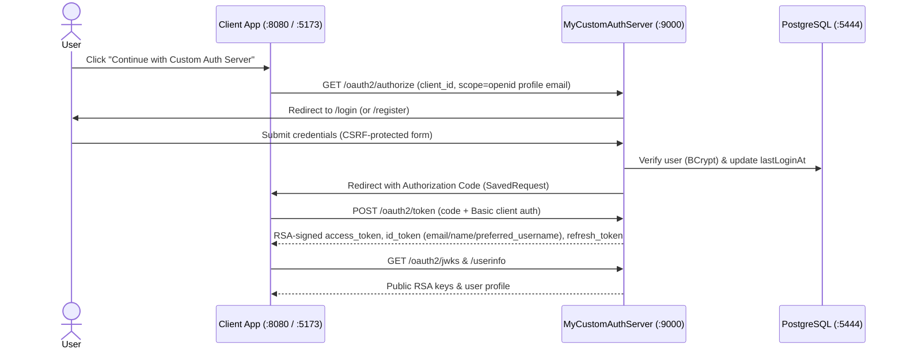
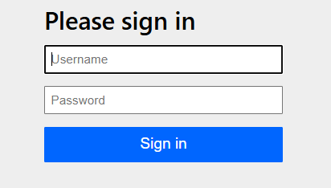
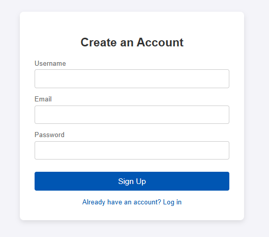
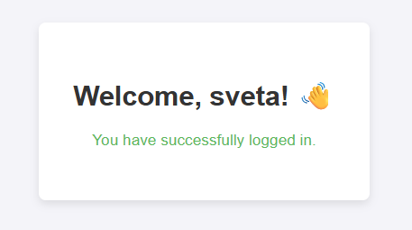
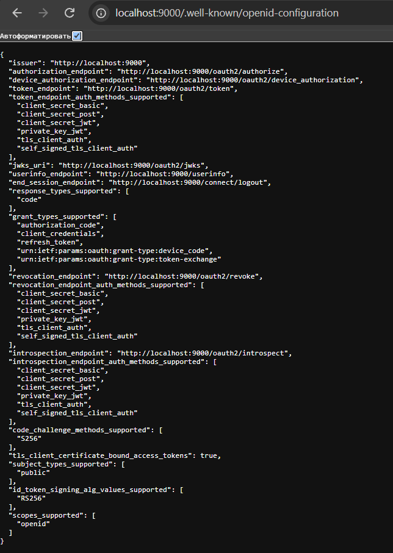
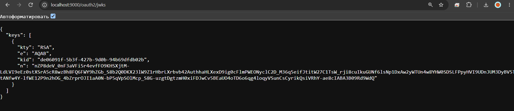
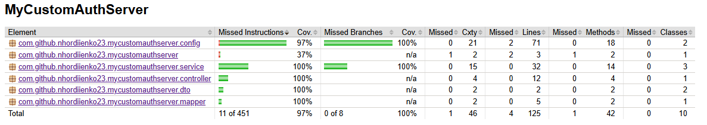

# MyCustomAuthServer


A standalone **OAuth2 Authorization Server** and **OpenID Connect (OIDC)** Identity Provider built with **Java 21, Spring Boot 3, Spring Authorization Server, and PostgreSQL**.

The server handles user registration and authentication, issues RSA-signed JWT access, ID, and refresh tokens, exposes standard OIDC discovery and JWKS endpoints, and acts as a centralized Identity Provider for external client applications such as [Team Management System](https://github.com/nhordiienko23/team-management-system).

## Demo
https://github.com/user-attachments/assets/50a81403-362b-4375-9bce-29ed27a78e24
## Features

- **OAuth2 Authorization Server:** Supports `authorization_code` and `refresh_token` grant types with `CLIENT_SECRET_BASIC` client authentication.
- **OpenID Connect (OIDC 1.0):** Supports `openid`, `profile`, and `email` scopes with standard discovery (`/.well-known/openid-configuration`) and `/userinfo` endpoints.
- **2048-bit RSA JWT Signing & JWKS:** Generates an RSA key pair for JWT signing and exposes the public key via `/oauth2/jwks` for stateless token verification.
- **Custom ID Token Claims:** Injects `email`, `name`, and `preferred_username` claims into issued OIDC `id_token` JWTs via `OAuth2TokenCustomizer`.
- **User Registration & Authentication:** Server-rendered Thymeleaf `/login`, `/register`, and `/` views backed by Spring Security, CSRF protection, custom `UserDetailsService`, Jakarta Validation, and BCrypt password hashing.
- **Login Activity Tracking:** Listens to Spring Security authentication success events and updates the user's `lastLoginAt` timestamp in PostgreSQL.
- **Containerized Local Setup:** Docker Compose runs the authorization server on port `9000` alongside PostgreSQL on port `5444`, using an isolated `AUTH_SESSION` cookie to avoid session collisions with local client apps.

## Technology Stack

| Area | Technologies |
| --- | --- |
| Backend | Java 21, Spring Boot 3.4.2, Spring Web MVC, Spring Data JPA, Hibernate, Jakarta Validation, Lombok |
| Security & Auth | Spring Security, Spring Authorization Server (OAuth2 / OIDC), 2048-bit RSA JWT, BCrypt |
| UI Templates | Thymeleaf (login, registration, and home views) |
| Database | PostgreSQL 16 |
| Testing & Coverage | JUnit 5, Spring Boot Test, MockMvc, Spring Security Test, Testcontainers (PostgreSQL 16), JaCoCo 0.8.12 |
| Infrastructure & Build | Docker, Docker Compose, Maven |

## Architecture



### Key Engineering Highlights

- **Ordered Dual Security Filter Chains:** `@Order(1)` isolates OAuth2/OIDC protocol endpoints and redirects unauthenticated browser requests to `/login`, while `@Order(2)` governs `/login`, `/register`, `/error`, and form authentication with `SavedRequestAwareAuthenticationSuccessHandler` so the authorization request resumes seamlessly after sign-in.
- **Enriched OIDC Identity Tokens:** `OAuth2TokenCustomizer` extracts `CustomUserDetails` during JWT encoding to inject `email`, `name`, and `preferred_username` into the `id_token`, enabling downstream apps to link accounts cleanly.
- **Isolated Session Management:** Renames the servlet session cookie to `AUTH_SESSION` to prevent `JSESSIONID` conflicts when running the Identity Provider and Spring Boot client applications simultaneously on `localhost`.
- **Real-Database Integration Testing:** `AbstractPostgreSqlIntegrationTest` spins up a shared `postgres:16-alpine` container via Testcontainers with `@DynamicPropertySource`, verifying registration, duplicate username handling, BCrypt hashing, CSRF enforcement, and OAuth2/OIDC security flows end-to-end.

## OAuth2 & OIDC Endpoints

| Endpoint | Purpose |
| --- | --- |
| `GET /.well-known/openid-configuration` | OpenID Connect provider metadata discovery |
| `GET /oauth2/authorize` | Authorization Code flow initiation |
| `POST /oauth2/token` | Exchange authorization code or refresh token for JWTs |
| `GET /oauth2/jwks` | Public RSA keys (JWK Set) for JWT signature verification |
| `GET /userinfo` | Authenticated user claims |
| `GET /login`, `GET /register` | User sign-in and account registration views |

## Getting Started

### Prerequisites

- **Docker & Docker Compose** (recommended for running the server and required for Testcontainers tests)
- **Java 21** and **Maven** (for local execution and running tests)

### 1. Clone and run with Docker Compose

```bash
git clone [https://github.com/nhordiienko23/MyCustomAuthServer.git](https://github.com/nhordiienko23/MyCustomAuthServer.git)
cd MyCustomAuthServer
docker compose up --build
```

The authorization server starts at **[http://localhost:9000](http://localhost:9000)** and PostgreSQL is exposed on port `5444`.

### Default Configuration & Registered Client

Default local development settings (`application.properties` & `AuthorizationServerConfig`):

| Setting | Default Value |
| --- | --- |
| Issuer / Server URL | `http://localhost:9000` |
| Database URL | `jdbc:postgresql://localhost:5444/my_auth_server_db` |
| Session Cookie Name | `AUTH_SESSION` |
| Client ID | `my-client-id` |
| Client Secret | `my-client-secret` (BCrypt-encoded in memory) |
| Client Auth Method | `CLIENT_SECRET_BASIC` |
| Redirect URIs | `http://localhost:8080/login/oauth2/code/my-custom-auth`<br>`http://localhost:5173/login/oauth2/code/my-custom-auth` |
| Grant Types | `authorization_code`, `refresh_token` |
| Scopes | `openid`, `profile`, `email` |

> **Note:** For local development, the 2048-bit RSA key pair and `RegisteredClient` are generated in memory on startup (`InMemoryRegisteredClientRepository`). In production, persist clients in a database and load signing keys from an external keystore or secret manager.

## Client Integration Guide

Configure a Spring Boot OAuth2 client (`application.yml`) to authenticate users through `MyCustomAuthServer`:

```yaml
spring:
  security:
    oauth2:
      client:
        registration:
          my-custom-auth:
            client-name: My Custom Auth
            client-id: my-client-id
            client-secret: my-client-secret
            authorization-grant-type: authorization_code
            redirect-uri: "{baseUrl}/login/oauth2/code/{registrationId}"
            scope:
              - openid
              - profile
              - email
        provider:
          my-custom-auth:
            authorization-uri: http://localhost:9000/oauth2/authorize
            token-uri: http://localhost:9000/oauth2/token
            user-info-uri: http://localhost:9000/userinfo
            jwk-set-uri: http://localhost:9000/oauth2/jwks
            user-name-attribute: sub
```

## Testing & Code Coverage

The test suite runs against real PostgreSQL 16 containers via **Testcontainers** (Docker must be running), using **JUnit 5, Spring Boot Test, MockMvc, and Spring Security Test** to verify registration, CSRF protection, authentication flows, OAuth2/OIDC endpoints, token customization, and login tracking.

Run all tests and generate the JaCoCo coverage report:

```bash
mvn clean verify
```

| Metric | Covered | Total | Coverage |
| --- | ---: | ---: | ---: |
| Instructions | 440 | 451 | **97%** |
| Branches | 8 | 8 | **100%** |
| Lines | 121 | 125 | **97%** |
| Methods | 41 | 42 | **98%** |
| Classes | 10 | 10 | **100%** |

HTML coverage report location: `target/site/jacoco/index.html`

## Project Structure

```text
MyCustomAuthServer/
├── src/
│   ├── main/
│   │   ├── java/com/github/nhordiienko23/mycustomauthserver/
│   │   │   ├── config/        # AuthorizationServerConfig (filter chains, clients, RSA JWK, TokenCustomizer)
│   │   │   ├── controller/    # /login, /register, and home endpoints
│   │   │   ├── dto/           # Registration DTOs & validation
│   │   │   ├── entity/        # JPA User entity
│   │   │   ├── mapper/        # DTO-to-entity mapping
│   │   │   ├── repository/    # Spring Data JPA UserRepository
│   │   │   └── service/       # CustomUserDetailsService, registration & login event handling
│   │   └── resources/
│   │       ├── templates/     # Thymeleaf views (login, register, home)
│   │       └── application.properties
│   └── test/                  # Testcontainers PostgreSQL 16 + MockMvc integration tests
├── docs/                      # Architecture diagram, screenshots, and coverage report
├── docker-compose.yml         # App (:9000) + PostgreSQL (:5444)
└── pom.xml                    # Maven dependencies, Testcontainers & JaCoCo setup
```

## Screenshots

### Login & Registration Views



### Home page


### OIDC Discovery 

### JWK Set


### JaCoCo Coverage Report

## Author

**Mykyta Hordiienko** — [GitHub](https://github.com/nhordiienko23)